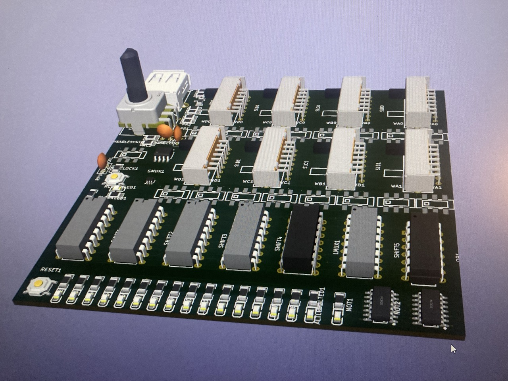
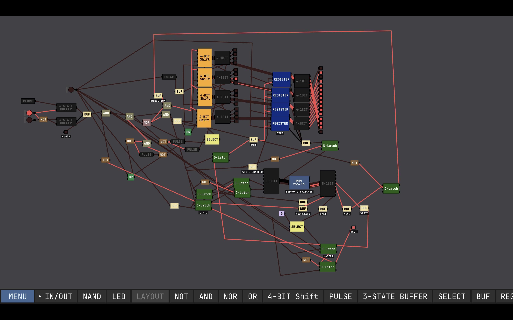
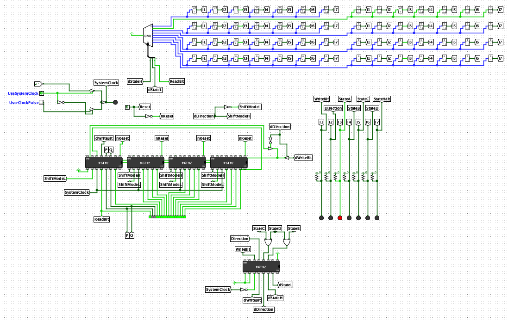
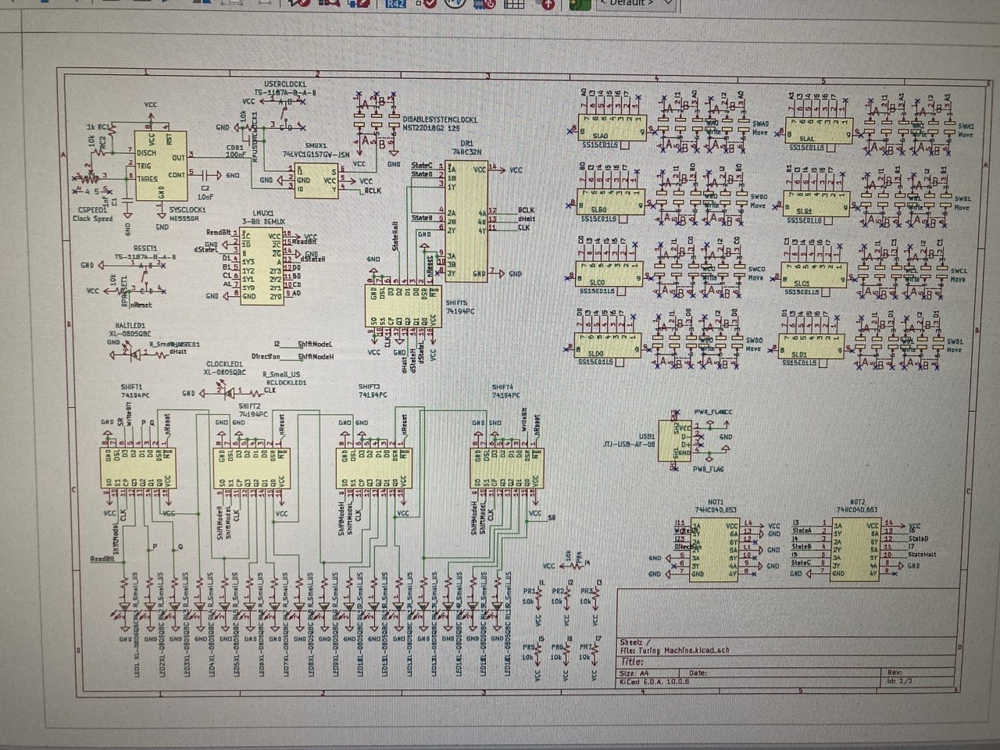
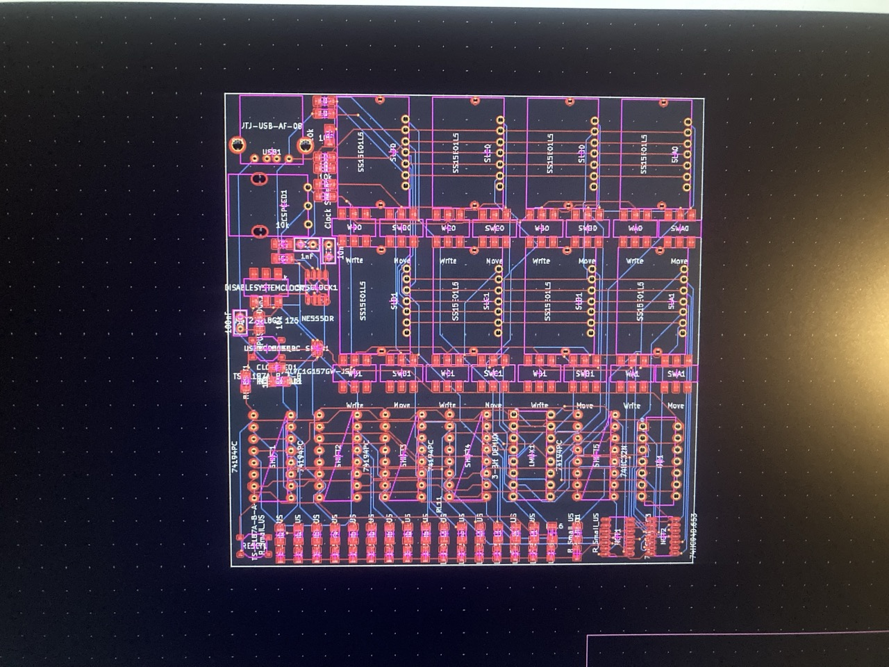

# Turing Machine
A programmable 4-state Turing Machine with a 16-bit circular tape running on a PCB.

### How does it work?

Turing Machines are the simplest form of computer - given a state table (a small program) and an infinite tape, Turing Machines can perform any computation.

My machine has 4 states (5 if you include HALT) and a 16 bit circular tape. It can't do much - but it can run basic programs like LED blinkers, counters, and the champion 4-state Busy Beaver machine (search it up!).

The bonus of this small design is this the program is * physical *, ie. you can edit the program the computer is running by flipping the ROM switches - in real time!

You can also manually step the clock, or use the built in one and control its speed. The machine has 16 LEDs showing the tape's content, one for showing whether the computer is halted, and one showing the HIGH / LOW pulses of the clock.

### How was it made?

I started by using Seb Lague's Digital Logic Sim to get a feel for the project, as it was a tool I was comfortable using.

I then switched to Logisim, simplifying to the best of my ability the routing and system design.

I then converted my logic into the physical world, selecting parts and wiring up my schematic in KiCad.

Finally, I arranged all my components in a small 10cm x 10cm package, and then I routed my PCB using `freerouter` (thank god for autorouting!).

### How do I build it?

To build this project, I recommend JLC's PCBA. I found it cost effective to have them assemble all the SMD components for you, and then solder the rest yourself.

The `kicad-jlcpcb-tools` folder has been provided in this repository as a direct drag and drop way to order this project from JLCPCB. `BOM (All parts).csv` also details every part needed for this project.

After ordering the PCBA, you have to order the rest of the components (through hole) which are listed below.

The BOM I ended up with looks like this:

| Item | Qty | Supplier | Cost/item | Total Cost | link |
|---|---|---|---|---|---|
| JLC PCBA | 1 | JLC PCB | $65.00 | $65.00 | https://jlcpcb.com |
| OR Gate | 5 | LCSC | $0.16 | $0.80 | https://www.lcsc.com/product-detail/C41427253.html |
| Slide Switches | 10 | LCSC | $0.32 | $3.20 | https://www.lcsc.com/product-detail/C1121868.html |
| Shift Registers | 5 | 1.9 | $0.38 | $1.90 | https://www.lcsc.com/product-detail/C22449650.html |
| 3-Bit DEMUX | 1 | LCSC | $1.51 | $1.51 | https://www.lcsc.com/product-detail/C1547279.html |
| USB Power Supply | 10 | LCSC | $0.06 | $0.60 | https://www.lcsc.com/product-detail/C2345.html |
| Pentiometer | 1 | LCSC | $2.07 | $2.07 | https://www.lcsc.com/product-detail/C5824127.html |
| Estimated total shipping | 1 |  |  | $15.00 |  |

For convenience, the full KiCad-exported BOM is here, however you will need to double check prices at the time of purchase, as they are not listed here.

| Designator | Footprint | Quantity | Value | LCSC Part # |
|---|---|---|---|---|
| C1 | C_Disc_D5.0mm_W2.5mm_P2.50mm | 1 | 1nF |  |
| C2 | C_Disc_D5.0mm_W2.5mm_P2.50mm | 1 | 10nF |  |
| CDB1 | C_Disc_D5.0mm_W2.5mm_P2.50mm | 1 | 100nF |  |
| CLOCKLED1, HALTLED1, LED1, LED10, LED11, LED12, LED13, LED14, LED15, LED16, LED2, LED3, LED4, LED5, LED6, LED7, LED8, LED9 | LED0805-R-RD | 18 | XL-0805QBC | C2293 |
| CSPEED1 | RES-ADJ-TH_PDB12-M4251-104BF | 1 | Clock Speed | C5824127 |
| DISABLESYSTEMCLOCK1 | SW-SMD_MST22D18G2 | 1 | MST22D18G2 125 | C2906280 |
| LMUX1 | PDIP-16_L19.3-W6.4-P2.54-LS7.9-BL | 1 | 3-Bit DEMUX | C1547279 |
| NOT1, NOT2 | SOIC-14_L8.7-W3.9-P1.27-LS6.0-BL | 2 | 74HC04D,653 | C5590 |
| OR1 | PDIP-14_L19.3-W6.5-P2.54-LS7.6-BL | 1 | 74HC32N | C41427253 |
| PR1, PR2, PR3, PR4, PR5, PR6, PR7, RC2, RPRESET1, RPUSERCLOCK1 | R1206 | 10 | 10k | C4410 |
| RC1 | R1206 | 1 | 1k | C4410 |
| RCLOCKLED1, RHALTED1, RL1, RL10, RL11, RL12, RL13, RL14, RL15, RL16, RL2, RL3, RL4, RL5, RL6, RL7, RL8, RL9 | R1206 | 18 | R_Small_US | C4410 |
| RESET1, USERCLOCK1 | SW-SMD_4P-L5.1-W5.1-P3.70-LS6.5-TL_H1.5 | 2 | TS-1187A-B-A-B | C318884 |
| SHIFT1, SHIFT2, SHIFT3, SHIFT4, SHIFT5 | PDIP-16_L19.3-W6.4-P2.54-LS7.94-BL | 5 | 74194PC | C22449650 |
| SLA0, SLA1, SLB0, SLB1, SLC0, SLC1, SLD0, SLD1 | SW-TH_SS15E01L5 | 8 | SS15E01L5 | C1121868 |
| SMUX1 | SOT-363_L2.1-W1.3-P0.65-LS2.3-BL | 1 | 74LVC1G157GW-JSM | C49006656 |
| SWA0, SWA1, SWB0, SWB1, SWC0, SWC1, SWD0, SWD1 | SW-SMD_MST22D18G2 | 8 | Move | C2906280 |
| SYSCLOCK1 | SOIC-8_L4.9-W3.9-P1.27-LS6.0-BL | 1 | NE555DR | C7593 |
| USB1 | USB-A-TH__USB-AF-90 | 1 | JTJ-USB-AF-08 | C2345 |
| WA0, WA1, WB0, WB1, WC0, WC1, WD0, WD1 | SW-SMD_MST22D18G2 | 8 | Write | C2906280 |